# WEB404 Secure Coding Practices — Assignment 4 Report

**Student:** Tenzin Namgay (Cuney)
**Student ID:** 02230307
**Topic:** SQL Injection

## Overview

I built a small Node.js + Express + SQLite app with four routes, each
intentionally vulnerable to a different type of SQL injection. I
performed all four attacks successfully, then fixed each route with
parameterized queries and re-tested each attack to confirm it no
longer works.

## 1. Authentication Bypass (Login)

### Vulnerable code
The login query was built by concatenating the username and password
directly into the SQL string.

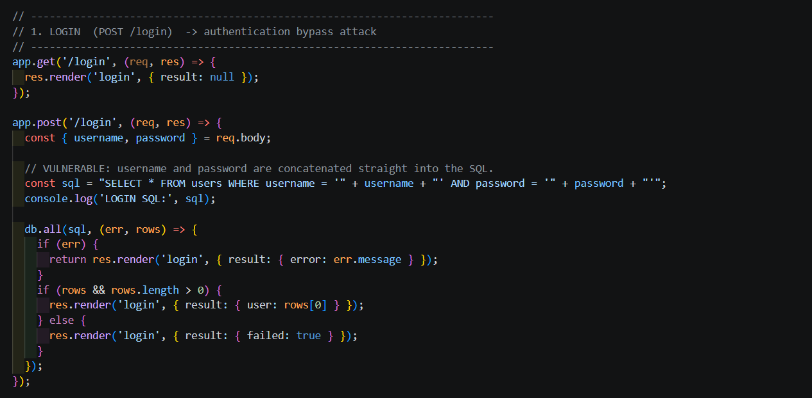

### Attack
I typed `admin' --` as the username and any password. The `--` comments
out the rest of the query, so the password check never runs.

The terminal log confirms the broken query:

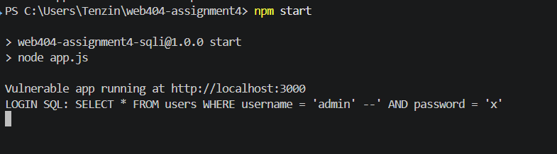

### Why it worked
The app never checks what the username actually contains. Because `--`
is a SQL comment marker, everything after it, including the password
check, was ignored. I logged in as admin without knowing the password.

### Fix
I changed the query to use `?` placeholders, with the username and
password passed separately as parameters instead of being inserted
into the string.

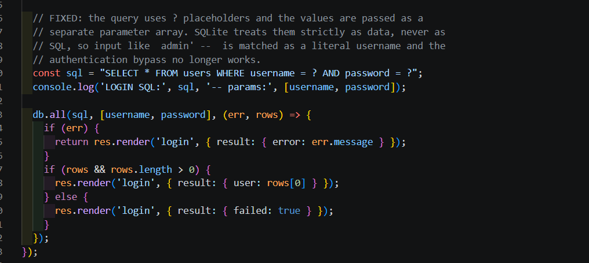

### Re-test
I tried the same payload again. This time it failed.

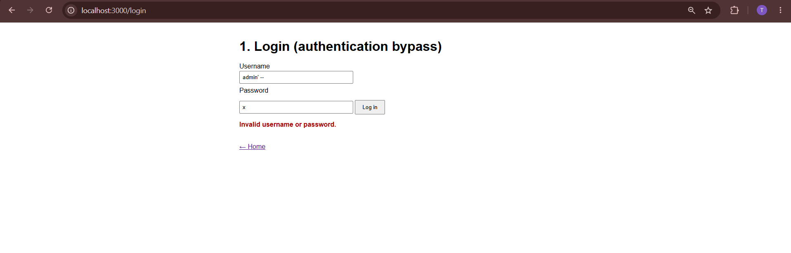

### Why the fix works
With parameterized queries, SQLite treats the input strictly as data,
never as part of the SQL command. The `--` is now just two characters
inside a password string, not a comment marker, so the bypass no
longer works.

## 2. UNION Based Injection (Product Search)

### Vulnerable code
The category filter was concatenated directly into the query.

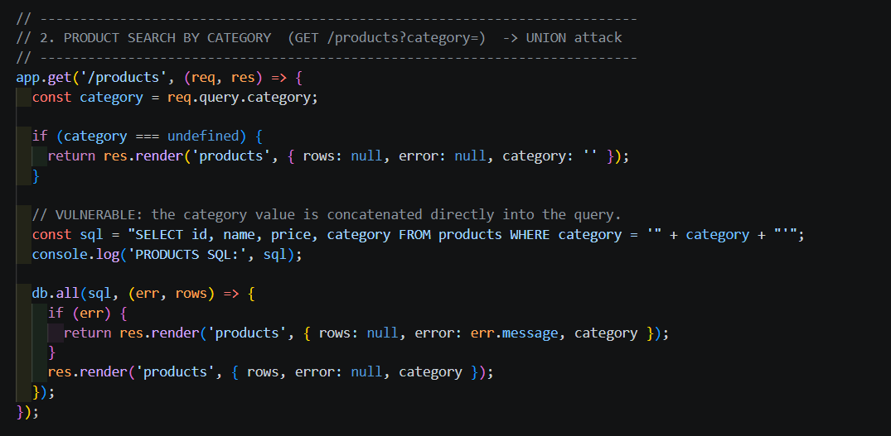

### Attack
I searched for:
`electronics' UNION SELECT id,username,password,role FROM users --`

This appended a second SELECT statement onto the original query,
pulling data from the users table into the same results table.

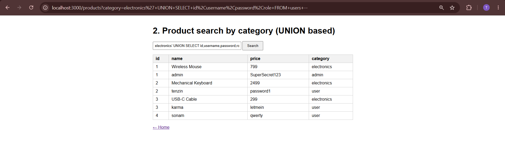

### Why it worked
The products table has 4 columns, and I matched that with 4 columns
in my UNION SELECT, so the database combined both result sets into
one table. Every username and password in the app showed up in what
was meant to be a product list.

### Fix
Same approach: the category is now passed as a bound parameter.

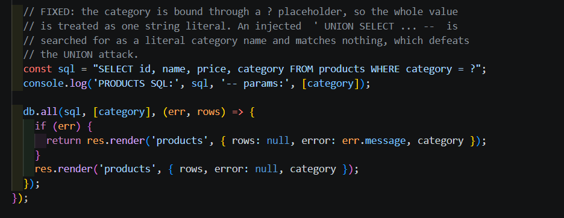

### Re-test
The same payload now returns no results.

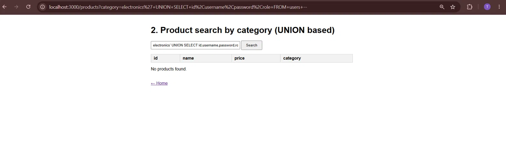

### Why the fix works
The whole payload, including the UNION keyword, is now treated as a
literal string being searched for in the category column. Since no
product has that exact category, nothing matches.

## 3. Error Based Injection (Product Lookup)

### Vulnerable code
The product id was concatenated into the query with no validation, and
the raw database error was shown on the page if the query broke.

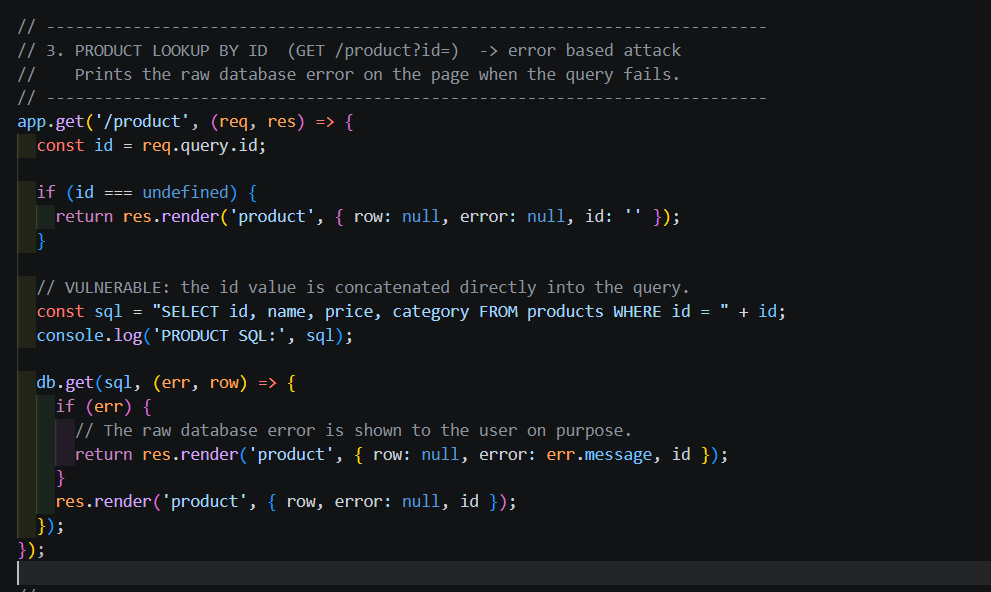

### Attack
I searched for product id `1'`, an unclosed quote that breaks the SQL
syntax.

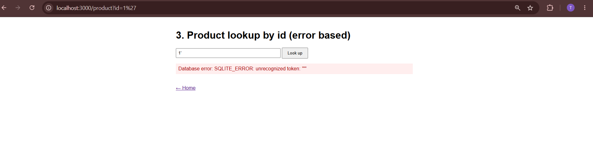

### Why it worked
The broken quote caused a SQL syntax error, and the app printed that
raw error straight to the page instead of handling it. This kind of
error message can reveal the database type and structure to an
attacker, which helps them craft further attacks.

### Fix
The id is now a bound parameter, and I added proper error handling so
the page shows a generic message instead of the raw error.

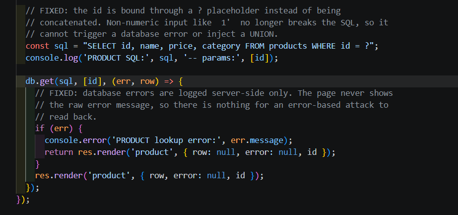

### Re-test
The same payload now shows a safe generic message.

### Why the fix works
The malformed quote is now just part of a literal id value being
compared in the query, so it no longer breaks the SQL syntax. On top
of that, any future errors are caught and hidden from the user.

## 4. Boolean Based Blind Injection (Check Username)

### Vulnerable code
The username check query was concatenated directly, with no data shown
back, only "exists" or "does not exist".

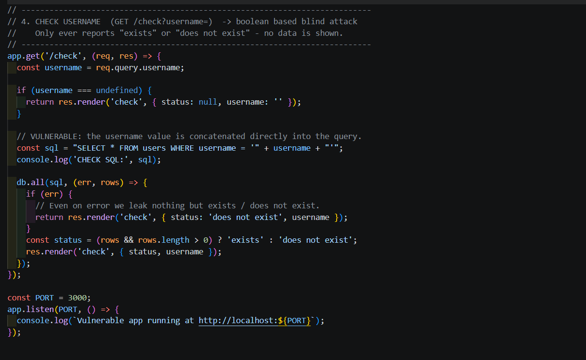

### Attack
I compared two payloads:
`admin' AND '1'='1` (always true) and `admin' AND '1'='2` (always false)

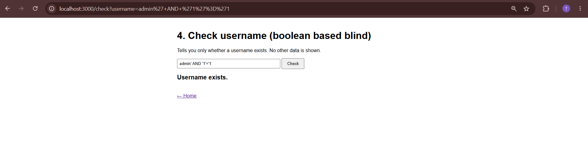
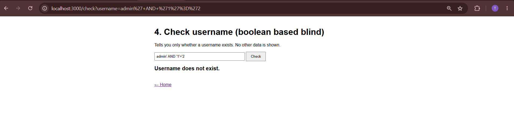

### Why it worked
Even though the page shows no actual data, the true and false
conditions returned different results ("exists" vs "does not exist").
An attacker can use this yes/no signal to slowly extract data one
true/false question at a time, for example checking each character of
a password with a condition like `substr(password,1,1)='S'`.

### Fix
The username is now a bound parameter.

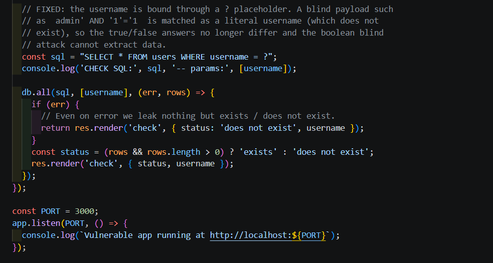

### Re-test
Both payloads now return the same result.

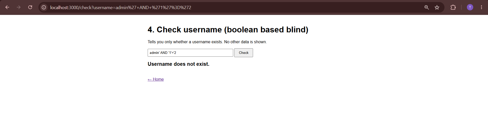

The terminal log shows all four fixed queries using parameters:

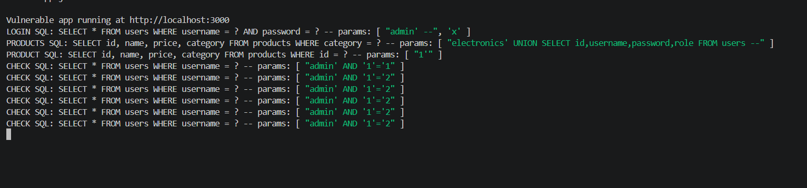

### Why the fix works
Since the payload is no longer interpreted as SQL, both the true and
false versions are just treated as literal strings that do not match
any real username. The true/false signal the attacker relied on is
gone.

## Summary

| Attack | Before fix | After fix |
|---|---|---|
| Auth bypass | Logged in without password | "Invalid username or password" |
| UNION based | Leaked all usernames and passwords | No results |
| Error based | Raw SQLite error shown | Generic "Product not found" |
| Boolean blind | True/false distinguishable | Both return "does not exist" |

All four vulnerabilities were fixed using parameterized queries, the
standard defense against SQL injection, since they stop user input
from ever being interpreted as part of the SQL command itself.
